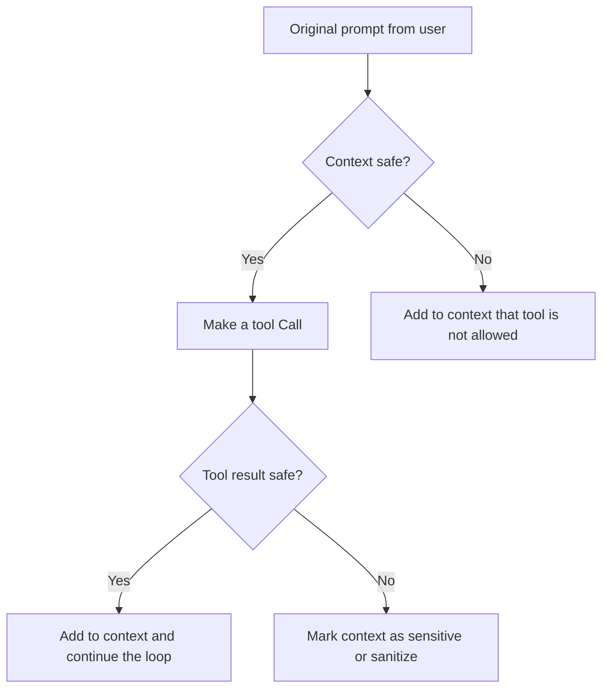

# Archestra Frontend Review — Patterns for a Future aisotropy Security/Observability UI

Date: 2026-07-17
Scope: `archestra-review/platform/frontend/` (TypeScript, Next.js) + `archestra-review/docs/pages/*.md`
Status: read-only, patterns-only research (see License Note at the end)

## Why this review

aisotropy is a Go LLM-agent runtime with guardrails (quarantine/sanitize, rate limiter, circuit
breaker, scope-gated tools, cost meter — `.claude/rules/architecture.md`) and OTel-shaped
observability hooks, but **no first-party UI today**. Archestra is an enterprise MCP security
platform whose entire pitch is "security and observability as first-class UI, not bolted on" —
its frontend is the single richest reference in this space for what a future aisotropy
control-plane UI could look like. This doc extracts the *architecture and UX patterns*, not code.

---

## 1. Stack

Confirmed by `archestra-review/platform/frontend/package.json` and `next.config.ts`:

- **Framework**: Next.js `16.3.0-canary.56`, App Router (`src/app/**`), React 19.2.4. This is a
  **web app**, not a desktop app — no Tauri/Electron anywhere in `platform/frontend/` (verified by
  the absence of any `tauri`/`electron` dependency or config file). The dev script
  (`scripts/dev.mjs`) auto-selects Turbopack vs. webpack per-platform to dodge a known
  `@next/swc-darwin-arm64` memory leak under Turbopack on macOS arm64 — a small but concrete
  "dev-experience engineering" detail worth noting.
- **State/data**: TanStack Query v5 (`@tanstack/react-query`) for all server state — every
  domain has a colocated `*.query.ts` file (e.g. `lib/policy.query.ts`, `lib/mcp/mcp-tool-call.query.ts`)
  wrapping fetch + cache keys + prefetch helpers. TanStack Table v8 for all data grids
  (`components/ui/data-table.tsx`). No Redux/Zustand — component state (`useState`) plus Query
  cache is the whole model.
- **UI primitives**: Radix UI (`@radix-ui/react-*`, and the newer consolidated `radix-ui` package)
  wrapped in a local `components/ui/*` shadcn-style layer, styled with Tailwind CSS 4
  (`tailwindcss: ^4`, `@tailwindcss/postcss`), `class-variance-authority` + `tailwind-merge` for
  variant composition, `lucide-react` for icons.
- **Chat/agent UI**: `@ai-sdk/react` + `ai` (Vercel AI SDK) drive the chat message stream and tool
  UI parts (`ToolUIPart` union — see §2). `streamdown` + `react-markdown` + `rehype-sanitize` /
  `rehype-raw` render assistant markdown safely; `dompurify` is a second sanitization layer.
  `mermaid` renders LLM-generated diagrams inline in chat (`components/mermaid-diagram.tsx`,
  used from `components/chat/conversation-artifact.tsx`) — the model can draw a flowchart and the
  UI renders it live in the conversation.
- **Editors/terminals**: `@monaco-editor/react` (e.g. the K8s YAML editor for MCP server config),
  `@xterm/xterm` + `@xterm/addon-fit` (an in-browser exec terminal against a running MCP server —
  `app/mcp/registry/_parts/mcp-exec-terminal.tsx`).
- **Charts**: `recharts` (cost/usage dashboards).
- **Auth**: `better-auth` (+ `@better-auth/sso`, `@better-auth/oauth-provider`) — SSO/OIDC/SAML,
  RBAC.
- **Testing**: Vitest + Testing Library for unit tests (co-located `*.test.ts(x)` next to nearly
  every non-trivial component — this is a strict, enforced convention, not an afterthought:
  dozens of files in `app/mcp/registry/_parts/` have a matching `.test.ts`), Playwright for
  integration/e2e (`tests-integration/`), Biome for lint/format, `knip` for dead-export detection,
  TypeScript project references.
- **Ops**: Sentry (`sentry.*.config.ts`), PostHog (`posthog-js`) for product analytics.

**Verdict on "is it a desktop app": no.** It's a conventional multi-tenant Next.js web
application served behind the Archestra backend; the closest thing to "desktop" is the in-browser
xterm exec console for MCP servers, which is a web terminal, not a native shell.

---

## 2. Security UX — how it visualizes and controls agent-tool risk

### 2.1 The core mental model: "context trust state," not literal taint tags

Archestra's docs (`docs/pages/platform-ai-tool-guardrails.md`) frame the problem as Simon
Willison's **"lethal trifecta"**: private-data access + untrusted-content exposure + external
communication ability, together, is what makes prompt injection dangerous. The UI never shows a
literal "taint" label; instead the *policy engine* treats conversation context as being in one of
two states — **safe** or **sensitive/untrusted** — and every tool call/result is evaluated against
that state:

*(reproduced from `docs/pages/platform-ai-tool-guardrails.md`, itself Archestra's own diagram of
its control flow — not proprietary code)*

Two independently configurable policy types implement this, both editable through a
rule-builder UI:

- **Tool Result Policies** (`lib/policy.utils.ts`): after a tool runs, its output is classified as
  one of `mark_as_trusted` ("Safe"), `mark_as_untrusted` ("Sensitive"), `sanitize_with_dual_llm`
  ("Dual LLM"), or `block_always` ("Blocked").
- **Tool Call Policies**: before a tool runs, the call itself is gated as
  `allow_when_context_is_untrusted` ("Allow always"), `block_when_context_is_untrusted` ("Block
  in sensitive context"), `require_approval`, or `block_always`.

Both policy types support **conditions** scoped to a specific tool: match on an argument value
(`equal`/`notEqual`/`contains`/`notContains`/`startsWith`/`endsWith`/`regex`), or on context
attributes like the calling agent ID or team. The condition-row editor
(`app/mcp/tool-guardrails/_parts/tool-call-policy-condition.tsx`) is a compact 3-column
parameter/operator/value picker with type-aware defaults (e.g. selecting "Teams" as the parameter
auto-switches the operator to `contains` and auto-fills the value if there's only one team) — a
small but well-thought-out reduction of clicks for the common case.

Per the docs, this trust state is **not reset by sub-agent delegation** — if a parent agent's
context has already gone "sensitive," a delegated sub-agent inherits that restriction. That's a
UX/product decision worth noting even though it's not itself a visual pattern.

### 2.2 Dual-LLM quarantine, visualized inline in the chat transcript

This is the single most interesting piece of UI in the whole review. When a tool result policy is
set to "Dual LLM," Archestra's backend runs a **Dual LLM Main Agent** (sees the user's question and
a redacted Q&A transcript, never the raw tool output) against a **Dual LLM Quarantine Agent** (sees
the raw/untrusted tool output, but can only answer constrained multiple-choice questions). The
frontend (`components/message-thread.tsx`, `components/ai-elements/tool.tsx`) renders this as part
of the normal tool-call bubble, not a separate screen:

- The tool call's status badge becomes `"Completed (dual LLM)"` (a distinct enum value,
  `output-available-dual-llm`, layered on top of the AI SDK's own `ToolUIPart["state"]` union) —
  same green dot as a normal success, different label, so a scanning user still recognizes "this
  succeeded" but the badge signals extra scrutiny happened.
- Inside the expanded tool card, the raw tool output is explicitly labeled **"Unsafe result"**
  instead of the ordinary "Result" label, so an admin auditing a transcript never mistakes
  quarantined data for accepted data.
- Below that, a **"Safe result"** panel shows only the sanitized summary the Main Agent was allowed
  to produce.
- Below *that*, a **"Questions and Answers"** panel renders the actual Main↔Quarantine
  conversation as a nested sub-thread (`ToolOutput` with a `conversations` prop) — so a security
  reviewer can literally read the multiple-choice interrogation that kept the untrusted text away
  from the primary model. A code comment in `tool.tsx` clarifies the inverted role convention for
  this sub-thread: *"In Dual LLM context, 'user' = Main Profile (questions), 'assistant' =
  Quarantined Profile (answers)."*

The effect: a reviewer scrolling a normal chat log sees quarantine events **as ordinary tool calls
with a different color/label**, and only has to expand one to get full forensic detail (unsafe
input → safe output → the exact Q&A that bridged them). Nothing about it requires a separate
"security dashboard" — the guardrail event *is* part of the conversation record.

### 2.3 Policy violations surface *in the chat*, with a same-screen fix action

`components/chat/policy-denied-tool.tsx` renders a blocked tool call as a `Tool` card with status
`output-denied`, a `ShieldX` icon, the parsed denial reason, and — if the viewer has
`toolPolicy: update` permission — an **"Edit policy" button right there in the chat bubble** that
opens `EditPolicyDialog` pre-scoped to that exact tool. If the viewer lacks permission, the button
is replaced by an inline explanatory message (customizable per-org via
`organization.chatErrorSupportMessage`) instead of just disappearing. This collapses what would
otherwise be a context switch ("go find this tool in the guardrails screen") into a one-click,
permission-aware fix loop embedded in the place where the failure was noticed.

The guardrails list screen (`app/mcp/tool-guardrails/page.client.tsx`) supports the mirror image
of this: a `?toolId=<id>&toolName=<name>` deep link opens the same `EditPolicyDialog` directly, so
an external notification/Slack alert about a blocked call can link straight into the fix screen.

### 2.4 Tool registry / catalog and OAuth reauthentication

`app/mcp/registry/` is the tool catalog: a searchable/filterable grid of MCP servers
(`CatalogFilters.tsx`, `InternalMCPCatalog.tsx`), each represented by a card
(`mcp-server-card.tsx`) that composes several small, independently testable status widgets:

- `transport-badges.tsx` — protocol/transport type (stdio/SSE/HTTP) as a compact badge.
- `deployment-status.tsx` — running/pending/failed state of a self-hosted server, sourced from the
  same enum the Prometheus metric `mcp_server_deployment_status` uses on the backend, so the UI
  label and the metric label never drift apart.
- `oauth-reauth-indicator.tsx` — a small amber "Needs re-authentication" marker. When the caller
  can act (`onActivate` provided), it's a real button that opens the credential surface; when they
  can't, the exact same markup renders as an inert `` with the same test id
  (`data-testid="oauth-reauth-state"`) — one component, two affordance levels, controlled entirely
  by whether a callback was passed in.
- Install/uninstall/reinstall flows go through explicit confirmation dialogs
  (`reinstall-confirmation-dialog.tsx`, `uninstall-server-dialog.tsx`) plus a live
  `installation-progress.tsx` bar with **named phases** (`pending → discovering-tools → success`)
  and an *animated but honest* progress fill: real phase transitions jump the bar to the phase's
  fixed checkpoint (33/66/100), then a `setInterval` creeps the displayed value up within the
  current phase at 0.5%/100ms purely so the bar never looks frozen while waiting on a real
  network/K8s event. A failed K8s deployment reuses the same component with a red bar and the raw
  deployment error text instead of inventing a separate failure UI.
- `mcp-tools-dialog.tsx` / `mcp-inspector.tsx` — browse the actual tool list a server exposes
  (dynamic tool discovery surfaced to the human, not just the LLM), and `mcp-exec-terminal.tsx` —
  an in-browser xterm shell to exec into a running MCP server container for live debugging.

### 2.5 Scope-gated tool assignment ("who/what can use this tool")

`app/apps/_parts/app-tools-editor.tsx` and the shared `components/agent-tools-editor.tsx` /
`ToolChecklist` implement the actual scope-gating UI: a checklist of tools **grouped by their
owning MCP server**, filtered to only the servers available in the current environment, with
built-in Archestra tools excluded from the assignable set. The same `ToolChecklist` component is
reused for both "which tools can this Agent call" and "which tools can this App call" — one
component, two call sites, keeping the scope model visually consistent across agent-type and
app-type principals. `AssignmentComboboxItem` / `AssignmentCombobox` genericizes the "search and
multi-assign" interaction so it isn't reimplemented per screen.

### 2.6 Audit log — git-diff-style before/after, not a raw JSON blob

`app/audit/logs/_components/audit-log-diff-view.tsx` renders every audit event's `before`/`after`
snapshot as a **unified diff** (`+`/`-`/context lines, green/red backgrounds, indentation
preserved) rather than two side-by-side JSON trees. It explicitly handles the edge cases a naive
diff view gets wrong: both snapshots `null` → "no tracked changes" (typical of pure auth events);
`before` `null` → every line is `added` (a create event); `after` `null` → every line is `removed`
(a delete event); both populated but identical → "No field-level differences between the
snapshots" instead of an empty-looking diff. Stable per-row React keys are computed from
`kind|indent|text` plus an occurrence counter so duplicate lines don't collide.

### 2.7 Observability surfaces

- **MCP Logs** (`app/mcp/logs/[id]/page.client.tsx`): a per-tool-call detail page — metadata card
  (agent, method, timing), collapsible JSON accordions for the raw tool call / tool result, an
  explicit error/success badge derived from `toolResult.isError`. Nothing exotic, but it's the
  correct "boring, scannable" shape for a trace-detail page.
- **Metrics** (backend-only, documented in `docs/pages/platform-observability.md`): Prometheus
  metrics like `mcp_tool_calls_total`, `mcp_tool_call_duration_seconds`,
  `llm_blocked_tools_total` (a counter *specifically* for guardrail-blocked calls), and OTel trace
  attributes including a client-supplied `archestra.external_agent_id` that is deliberately kept
  out of metric label sets to avoid unbounded cardinality, but *is* attached to traces/logs where
  high-cardinality is fine. That label-vs-attribute split is a reusable operational lesson
  independent of any UI.
- **Cost**: `components/cost.tsx` — a two-line `formatCost()` helper that switches between
  exponential, 6-decimal, and 4-decimal formatting based on magnitude, so a $0.0000003 embedding
  call and a $12.40 chat session both render as sensibly-precise, non-ridiculous strings in the
  same table column.

---

## 3. Notable interaction/component patterns worth learning (top 5)

1. **Guardrail events render as normal chat/tool-call UI with a state variant, not a separate
   screen.** Both the Dual-LLM quarantine flow (§2.2) and policy denial (§2.3) are additional
   states of the *same* `Tool`/`ToolHeader` component that renders ordinary tool calls (an
   extended `state` union: `output-available-dual-llm`, `output-denied` layered on top of the AI
   SDK's `ToolUIPart["state"]`). A reviewer never has to leave the conversation to see that
   something security-relevant happened; they only have to leave it to *change the policy*, and
   even that is one click away via an inline button.

2. **Permission-aware components render, not hide, when the user can't act.** `PermissionButton`
   (disabled + tooltip explaining the missing permission, rather than disappearing) and
   `OAuthReauthIndicator` (inert `` vs. clickable `<button>`, same markup either way) both
   choose "show the state, gate the action" over "hide the whole thing." This keeps the security
   posture visible to every viewer regardless of role, which matters for an audit-heavy product.

3. **Rule-builder condition editor with type-aware field behavior.** The tool-call/result policy
   condition row (parameter → operator → value) narrows the operator list and pre-fills the value
   based on which parameter was picked (e.g., picking "Teams" restricts operators to
   `contains`/`notContains` and auto-selects the only team if there's just one). This is a small,
   generalizable pattern for any "if X compare-op Y then action" rule builder — including a future
   aisotropy scope-policy editor.

4. **Deep-link a specific record's edit dialog via query params.** `?toolId=<id>&toolName=<name>`
   opening `EditPolicyDialog` directly (from both an in-chat denial and an external link) is a
   cheap, URL-shareable way to route a human straight to the fix for a specific finding — useful
   for a future aisotropy alert (Slack/PagerDuty) that needs to link into "the guardrail that just
   fired."

5. **Honest-but-alive progress bars for opaque async backends.** `installation-progress.tsx`'s
   named-phase + creeping-interpolation technique (jump to the real checkpoint on a real event,
   creep smoothly *within* the current phase so the UI never looks stalled) is directly reusable
   for any long-running, coarse-grained backend process where you only get 2-3 real signals (e.g.
   aisotropy's sleep-cycle DataFusion subprocess, or a future "consolidation running" indicator).

Honorable mention: the git-diff-style audit view (§2.6) and the `mcp_tool_calls_total` /
`llm_blocked_tools_total` metric-label-vs-trace-attribute cardinality split (§2.7) are both strong,
just narrower in applicability than the top 5.

---

## 4. Inspiration for aisotropy (patterns, not code)

aisotropy already has the backend primitives Archestra's UI is built to visualize: quarantine/
sanitize handling, scope-gated tools (`internal/routing` / Phase 7 granular control), a rate
limiter + circuit breaker, a cost meter, and the fail-closed reflection loop
(`.claude/rules/constitutional-gates.md`). It has no UI yet. If/when one is built, this review
suggests:

- **Model guardrail state as an explicit enum on the tool-call/message data structure**, mirrored
  in both the SSE stream payload and any future stored trace — e.g. an aisotropy analogue of
  `output-available` / `output-available-dual-llm` / `output-denied` for
  quarantine-sanitized / rate-limited / circuit-broken / scope-denied outcomes, so a UI (or even
  just a `jq`-able log line) can render "this call succeeded, but under quarantine" without a
  human having to reconstruct that from separate rate-limiter and quarantine logs.
- **Surface guardrail/quarantine events inline in whatever renders the SSE chat stream**, not in
  a separate admin screen — same "unsafe vs. safe result" labeling split Archestra uses, so a
  quarantined tool result is visually distinguishable from a normal one at a glance, with the raw
  vs. sanitized payload both inspectable on demand.
  - Aisotropy's `internal/llm` reflection loop already produces a structured "schema violation →
    retry" event on the non-streaming path (per `constitutional-gates.md`); the same
    state-variant-on-existing-component approach used for Dual-LLM (§2.2) would let a future UI
    show "self-repaired after 1 retry" as a status variant on the normal response bubble instead
    of a separate log view.
- **A condition-row policy editor for scope-gated tools**, generalizing "if tenant/user/tool-arg
  X compare-op Y then allow/deny/require-approval" — directly analogous to aisotropy's scope-gated
  tools (Phase 7) and the multi-tenant isolation rule that `tenant_id` must travel only via
  `context.Context` (`constitutional-gates.md`). A UI condition builder should surface *only*
  tenant-scoped attributes (never let an operator author a cross-tenant condition), inheriting
  Archestra's UX shape (§2.1/§3.3) without inheriting its code.
- **Cost meter formatting**: the magnitude-adaptive `formatCost()` (exponential / 6dp / 4dp
  by threshold) is a two-line utility worth reproducing verbatim-in-spirit for aisotropy's
  existing `GET /costs` endpoint once it gets a UI — a $0.0000004 embedding call and a $2.10 chat
  session both need to render sensibly in the same column.
- **Health/readiness as a phased, honestly-animated progress indicator**: aisotropy's
  `GET /health` already runs bounded, parallel, tenant-scoped probes against facts/semantic tiers
  (`services-config.md`); a future ops UI could reuse the "named phase + interpolated creep"
  pattern (§3.5) for the sleep-cycle DataFusion subprocess run, which currently only emits a
  process exit code with no intermediate progress signal today — this UX pattern doesn't require
  the backend to expose more than 2-3 checkpoints to feel alive.
- **Audit trail as diff, not raw JSON**: if/when aisotropy adds an admin audit log for
  policy/scope/quota changes, the null-before/null-after/both-populated diff-view branching
  (§2.6) is a small, well-tested shape worth copying *conceptually* — every audit UI hits the same
  three edge cases (create/delete/update) and Archestra's tests already enumerate them.
- **Permission-aware, not permission-hiding, components**: any future aisotropy admin UI (e.g. for
  editing rate-limit tiers or scope policies) should keep the *state* visible to all viewers and
  gate only the *action* button, per §3.2 — consistent with the project's own "reject/degrade
  before spending tokens" transparency stance in `constitutional-gates.md`.
- **Stack choice, if a UI is ever built**: Next.js App Router + TanStack Query + Radix/Tailwind is
  a reasonable, boring, well-trodden combination for a Go-backed admin/observability SPA — no
  novel infra risk, and it would sit naturally in front of aisotropy's existing Huma-generated
  OpenAPI contract (the Go struct-as-contract already gives a TanStack-Query-friendly typed
  client for free via codegen, the same role `@archestra/shared`'s `archestraApiTypes` plays here).

None of the above requires or suggests importing any Archestra code, dependency, or asset —
every item above is a UX/architecture *shape*, independently implementable against aisotropy's own
Go/Huma backend and MIT/Apache-2.0 stack.

---

## 5. License note (read carefully before reusing anything from this review)

`archestra-review` is dual-licensed **AGPL-3.0** (`LICENSE_AGPL`) plus a separate **Enterprise**
license (`LICENSE_ENTERPRISE`) — see `archestra-review/LICENSE.md`. Per aisotropy's own
`.claude/rules/cos/license-policy.md`, AGPL is **blocked** for this SaaS project: it is not safe to
vendor, import, adapt-with-attribution, or copy any source, config, or asset from
`archestra-review` into aisotropy. This document is a **clean-room, read-only, patterns-only**
review:

- No code from `archestra-review` was copied into aisotropy or into this document beyond what
  Archestra's own public docs already state as prose (e.g. the "lethal trifecta" mermaid diagram
  in §2.1, which is Archestra's own architecture-explainer diagram, reproduced as a description of
  their *documented* control flow, not extracted source).
- Every "inspiration" item in §4 is phrased as a pattern/shape to *reimplement independently*
  against aisotropy's own Go/MIT/Apache-2.0 stack — never as "port this file" or "adapt this
  component."
- Do not vendor, npm-install, or otherwise import any `archestra-review/platform/frontend`
  package, component, or asset into aisotropy. If a future aisotropy UI is built, it should be a
  clean-room implementation informed by the *ideas* in this document only.
